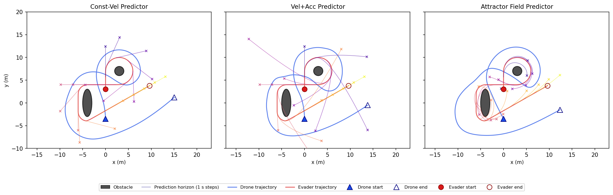

## [Occlusion-Aware Drone Tracking](projects/occlusion-drone.qmd)

Model predictive control for a drone following a moving target around obstacles while preserving line of sight. I developed the planar dynamics, simulation environment, SLSQP-MPC controller with three target predictors, and evaluation scripts.

[Explore the project](projects/occlusion-drone.qmd)
