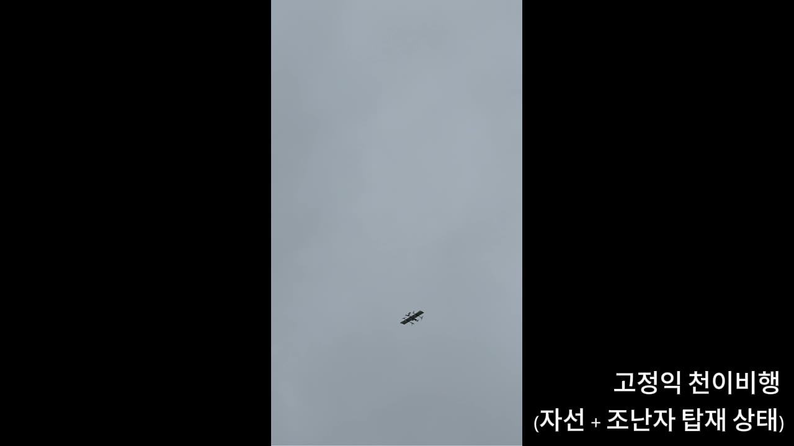
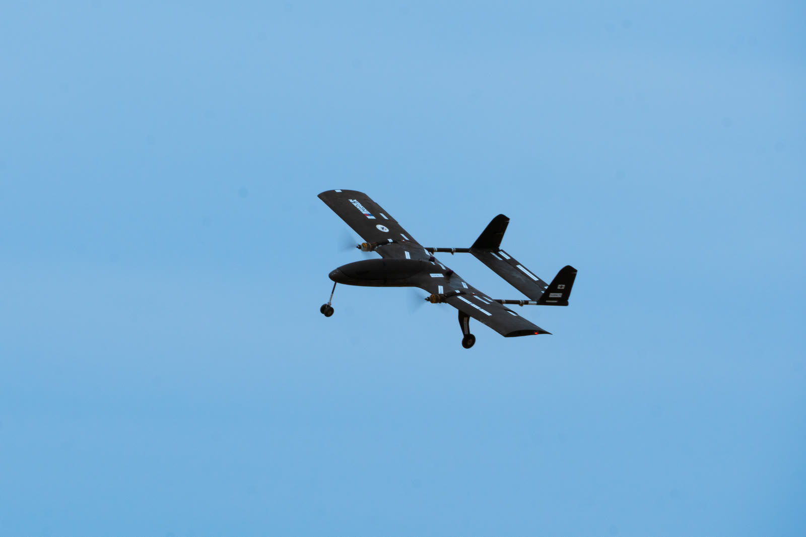
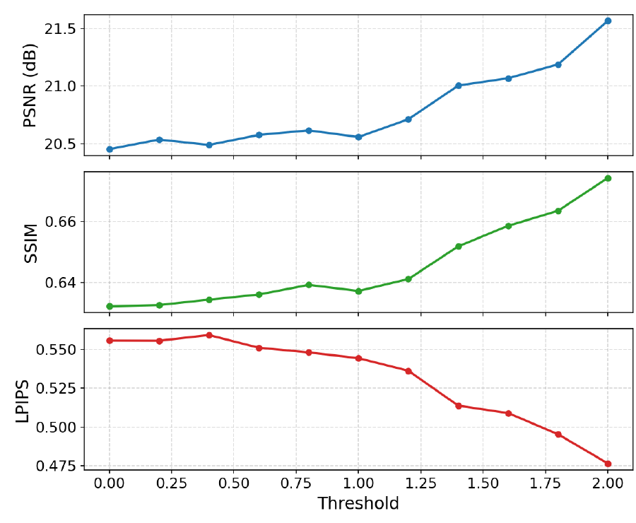

## [Occlusion-Aware Drone Tracking](projects/occlusion-drone.qmd)

Model predictive control for a drone following a moving target around obstacles while preserving line of sight. I developed the planar dynamics, simulation environment, SLSQP-MPC controller with three target predictors, and evaluation scripts.

[Explore the project](projects/occlusion-drone.qmd)

## [Autonomous Rescue VTOL Aircraft](projects/robot-aircraft-competition.qmd)

A VTOL aircraft with visual target recognition for the 23rd Korea Robotic Aircraft Competition. I worked on YOLO and ROS 2 perception and control software for target recognition and alignment. Our team placed in the top 7 of 37 teams.

[Explore the project](projects/robot-aircraft-competition.qmd)

## [2025 AIAA Design/Build/Fly](projects/aiaa-dbf-2025.qmd)

CFD team leadership for Team Korea's competition aircraft. My work covered airfoil selection, automated aerodynamic analysis with Ansys Fluent, and fluid–structure interaction analysis with Ansys Mechanical.

[Explore the project](projects/aiaa-dbf-2025.qmd)

## [Motion Blur in Aerial 3D Reconstruction](projects/cs592-aerial-reconstruction.qmd)

My main contribution to this CS592 team project was analyzing how motion-blurred training images affect 3D Gaussian Splatting. FFT-based frame filtering improved held-out PSNR by 1.12 dB at the best tested threshold on one UAVScenes sequence. I also helped explore altitude, reconstruction, and semantic understanding.

[Explore the project](projects/cs592-aerial-reconstruction.qmd)
